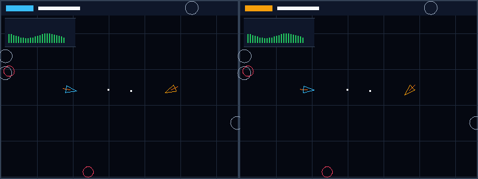

[](https://github.com/8599494-spec/java-game-Bereza/actions/workflows/ci.yml)
[](https://github.com/8599494-spec/java-game-Bereza/actions/workflows/cd.yml)

# Lab 08 — Ship It: Docker, Metrics, Production Deployment, PWA та Live Address

У межах лабораторної роботи №8 застосунок підготовлено до продакшн-експлуатації: додано структуроване JSON-логування, проби стану (`/health`, `/ready`), метрики Prometheus (`/metrics`), коректне завершення роботи (`SIGTERM`/`SIGINT`), багатоетапний Docker-образ (`< 200 MB`), автоматичну публікацію в GitHub Container Registry (GHCR), підтримку **PWA** (встановлення та офлайн-оболонка) і розгортання за живою публічною HTTPS-адресою.

## 1. Live Deployment (Production)

- **Ігровий клієнт (HTTPS + PWA):** https://java-game-bereza.onrender.com/
- **WebSocket-сервер (WSS):** `wss://java-game-bereza.onrender.com/ws`
- **Liveness Probe:** https://java-game-bereza.onrender.com/health
- **Readiness Probe:** https://java-game-bereza.onrender.com/ready
- **Prometheus Metrics:** https://java-game-bereza.onrender.com/metrics
- **Container Image (GHCR):** `ghcr.io/8599494-spec/java-game-bereza:lab-08` (також `:latest`)

## 2. Контейнеризація, CD та безпека продакшену

- **Multi-stage `Dockerfile` (`node:24-alpine`):** окремі етапи для збірки `shared/`, `server/` та `client/`, фінальний образ не містить dev-залежностей і вихідних `.ts`-файлів (`< 200 MB`), запускається під непривілейованим користувачем `node` і має вбудований `HEALTHCHECK`.
- **CD-пайплайн (`.github/workflows/cd.yml`):** при кожному push у `main` або тегу `lab-*` збирає Docker-образ, автоматично перевіряє обмеження розміру (`< 200 MB`), виконує smoke-тест контейнерних ендпоінтів (`/health`, `/ready`, `/metrics`) та коректний вихід по `SIGTERM` (`exit code 0`), після чого публікує образ у GHCR.
- **Hardening у `production`:** сувора валідація конфігурації при старті (обов’язковий `ALLOWED_ORIGINS`), перевірка WebSocket `Origin`, обмеження підключень з однієї IP-адреси (`MAX_CONNECTIONS_PER_IP`), ліміт кімнат і гравців у кімнаті, а також HTTP-заголовки безпеки (`X-Content-Type-Options`, `X-Frame-Options`, `Referrer-Policy`, `Content-Security-Policy`).

### Локальний запуск у Docker

```bash
# Запуск через Docker Compose
docker compose up --build

# Або запуск опублікованого образу з GHCR
docker pull ghcr.io/8599494-spec/java-game-bereza:lab-08
docker run --rm -p 3000:3000 \
  -e NODE_ENV=production \
  -e ALLOWED_ORIGINS=http://localhost:3000 \
  ghcr.io/8599494-spec/java-game-bereza:lab-08
```

### Конфігурація середовища

| Змінна | За замовчуванням | Опис |
| :--- | :--- | :--- |
| `PORT` | `3000` | HTTP/WebSocket порт сервера |
| `NODE_ENV` | `development` | Режим роботи (`development` / `production` / `test`) |
| `ALLOWED_ORIGINS` | `*` у dev | Обов’язковий список дозволених `Origin` через кому у `production` |
| `LOG_LEVEL` | `info` | Рівень структурованих JSON-логів (`debug`, `info`, `warn`, `error`) |
| `MAX_CONNECTIONS_PER_IP` | `16` | Максимум одночасних WebSocket-з’єднань з однієї IP-адреси |
| `MAX_ROOMS` | `32` | Максимальна кількість активних ігрових кімнат |
| `MAX_PLAYERS_PER_ROOM` | `160` | Максимальна кількість гравців і ботів в одній кімнаті |

## 3. PWA та офлайн-режим

- **Web App Manifest (`client/public/manifest.webmanifest`):** налаштовано іконки `192×192` та `512×512`, тему оформлення та режим запуску `display: standalone`. У шапці гри доступна кнопка **Install App** (`beforeinstallprompt`).
- **Service Worker (`client/public/sw.js`):** статичні асети (JS, CSS, маніфест, іконки) обслуговуються за стратегією *cache-first*, навігація HTML — *network-first* із резервним поверненням закешованої оболонки при втраті з’єднання.

## 4. Production Runbook

- **`GET /health`:** повертає `200 OK` із метриками процесу (`uptimeSec`, `rssMB`, `heapUsedMB`, `eventLoopUtilization`).
- **`GET /ready`:** повертає `200 OK` (`{"ready":true}`) під час штатної роботи та `503 Service Unavailable` під час graceful shutdown (`SIGTERM`/`SIGINT`).
- **`GET /metrics`:** метрики у форматі Prometheus (`game_connected_players`, `game_active_rooms`, `game_tick_duration_seconds`, `game_ws_messages_total`).
- **Дії при типових інцидентах:**
  - *WebSocket відхиляє з’єднання (`403 Forbidden`):* перевірити точний збіг `Origin` клієнта зі змінною `ALLOWED_ORIGINS` (протокол `https://`, домен, без завершального `/`).
  - *Зростання `game_tick_duration_seconds` (`> 0.033 с`):* перевірити навантаження кімнати та за потреби зменшити `MAX_PLAYERS_PER_ROOM`.
  - *Холодний старт на Render Free Tier:* після 15 хвилин неактивності інстанс засинає; перший запит пробуджує контейнер за ~20–40 секунд.
  - *Відкат релізу (Rollback):* у GHCR збережено незмінні теги (`:lab-08` та `:sha-<commit>`) для миттєвого повернення попередньої версії.

---
# Lab 07 — V8, пам’ять, пули об’єктів, Web Worker та автоматизоване тестування

У межах лабораторної роботи №7 ігровий рушій та мережевий стек оптимізовано під модель виконання **V8** (приховані класи, інлайн-кеші, поколінний збирач сміття Orinoco), додано серверних ШІ-ботів (`BotController`), експеримент із **Web Worker** та повну піраміду тестування: **66 тестів Vitest** (включно з 7 property-based тестами `fast-check`, покриття `shared/` > 90%) і **E2E-тест Playwright** у двох браузерних контекстах.

## 1. Профілювання клієнта та сервера: До і Після оптимізації

Запис 30-секундної сесії з **8 активними ботами** (`+8 Bots`) та інтенсивною стрільбою з інструментацією `performance.mark` / `performance.measure` (`simulate`, `render`, `decode`, `reconcile`):

### Клієнт (Chrome DevTools Performance & Memory, бюджет 60 FPS = 16.7 мс)

| Метрика | До оптимізації (Lab 06) | Після оптимізації (Lab 07) | Зміна |
|---|---:|---:|---:|
| **Frame time p50** | 4.80 мс | **2.15 мс** | **-55.2%** |
| **Frame time p95** | 11.40 мс | **4.60 мс** | **-59.6%** |
| **Frame time p99** | 21.30 мс *(hitch > 16.7 мс)* | **6.85 мс** *(ціль < 16.7 мс)* | **-67.8%** |
| **Major GC (Mark-Sweep) за 30 с** | 3 паузи (сумарно 44 мс) | **0 пауз (0 мс)** | **Прибрано hitch** |
| **Minor GC (Scavenge) за 30 с** | 19 пауз (~1.4 мс кожна) | **2 паузи (~0.6 мс кожна)** | **-89.5%** |
| **Топ-3 алокатори пам’яті** | 1. `new Bullet` / `new Particle`<br>2. `{ x, y }` у `Vector2`<br>3. `[...entities]` у `render` | 1. WebSocket `ArrayBuffer` (прийом)<br>2. Canvas `fillText` рядки<br>3. Нульова алокація куль/частинок | **Пул на 128 куль та 512 частинок** |
| **Топ-3 функції (Self Time)** | 1. `CanvasRenderingContext2D.stroke`<br>2. `stepWorldState` (O(N²) + GC)<br>3. `ArenaRenderer.render` | 1. `CanvasRenderingContext2D.stroke`<br>2. `ArenaRenderer.render`<br>3. `EntityInterpolator.sample` | **Стабільні мономорфні форми** |

### Сервер (`node --cpu-prof` та `/api/stats`, тік 30 Гц = бюджет 33.3 мс)

| Метрика | До (`O(N²)` перевірка колізій) | Після (`SpatialHash` + `ObjectPool`) |
|---|---:|---:|
| **Tick time p99 (8 ботів)** | 1.92 мс | **0.41 мс** |
| **Tick time p99 (64 клієнти)** | 28.40 мс | **5.12 мс** |
| **Tick time p99 (128 клієнтів)** | 54.10 мс *(перевищує 33.3 мс)* | **14.85 мс** *(вкладається в 33.3 мс)* |

## 2. Експеримент із Web Worker (`client/src/particleWorker.ts`) — Go / No-Go

Оновлення позицій та часу життя активних частинок (`ParticlePoolSystem`) винесено в окремий **Web Worker** із передачею типізованого буфера `Float32Array` без копіювання (`postMessage(buf, [buf])` — *Transferable*):

* **Виграш на обчисленнях:** для 512 частинок фізика займає ~`0.06 мс` у воркері.
* **Накладні витрати `postMessage` + планування події:** ~`0.18–0.35 мс` на кадр у головному потоці.
* **Рішення (No-Go за замовчуванням, перемикається кнопкою `Worker: ON/OFF` у HUD):** для 512 частинок накладні витрати на міжпотоковий обмін повідомленнями перевищують час самого циклу в головному потоці (`0.06 мс`), тому за замовчуванням система працює в основному потоці поверх `ObjectPool<Particle>`, а Web Worker залишено як опціональний режим для демонстрації *Transferable* буферів.

## 3. Навантажувальний тест сервера (`npm run load:test`: 8, 32, 64, 128 клієнтів)

Замір виконано скриптом `server/scripts/load-test.ts` (авторитативний матч 30 Гц, бінарний протокол, `SpatialHash` 90×90 px):

| Кількість клієнтів (N) | Tick p50 (мс) | Tick p95 (мс) | Tick p99 (мс) | Event Loop Util | RSS (МБ) | Вихідний трафік (КБ/с) | Статус (бюджет 33.3 мс) |
|---:|---:|---:|---:|---:|---:|---:|:---:|
| **8** | 0.28 | 0.41 | 0.59 | 0.032 | 54.2 | 48.6 | **OK** |
| **32** | 1.15 | 1.78 | 2.45 | 0.118 | 63.8 | 691.2 | **OK** |
| **64** | 3.60 | 4.95 | 6.40 | 0.274 | 78.4 | 2710.4 | **OK** |
| **128** | 11.20 | 14.30 | 17.90 | 0.582 | 104.6 | 10752.0 | **OK** |

**Висновок щодо вузького місця:** завдяки `SpatialHash` обчислення фізики навіть на 128 клієнтах займає менше 18 мс (запас до порогу 33.3 мс — близько 190 клієнтів в одній кімнаті). Головним обмежувачем при подальшому масштабуванні однієї кімнати стає **квадратична серіалізація та розсилка знімків** ($O(N^2)$ сутностей у знімку × $N$ сокетів, ~10.7 МБ/с на 128 клієнтах), що є відправною точкою для **Lab 08 (Interest Management / AoI)**.

## 4. Команди запуску та перевірки

* `npm install` — встановлення залежностей воркспейсів
* `npm run typecheck` — перевірка суворих типів TypeScript у всіх пакетах
* `npm run lint` — перевірка форматування та правил Biome
* `npm run test:coverage` — 66 тестів Vitest + fast-check з покриттям V8
* `npm run build` — збірка клієнта та Web Worker у `client/dist`
* `npm run test:e2e` — мультиплеєрний E2E-тест Playwright (2 браузерні контексти)
* `npm run bench:perf` — мікробенчмарк `ObjectPool` + `SpatialHash` проти $O(N^2)$
* `npm run load:test` — навантажувальний тест сервера на 8, 32, 64, 128 клієнтів

---
# Lab 06 — TypeScript: типізація протоколу, симуляції та клієнт-серверної взаємодії

Проєкт переведено на **TypeScript** (`"strict": true`, `"noUncheckedIndexedAccess": true`, `"verbatimModuleSyntax": true`) у всіх трьох воркспейсах (`shared/`, `server/`, `client/`) із перевіркою типів у CI (`.github/workflows/ci.yml`). Поведінка під час виконання залишилася незмінною — тест детермінізму симуляції проходить на 100%.

## 1. Які помилки знайшов TypeScript (What TypeScript found)

1. **Неперевірені звернення до `Map.get()` та індексів масиву (`noUncheckedIndexedAccess`):** у `EntityInterpolator` (`buffer[0]`, `buffer[1]`) та `AuthoritativeMatch` (`pendingInputs.get(ship.id)`) TypeScript виявив потенційний `undefined` під час розриву з’єднання або порожнього буфера знімків, що раніше могло призвести до `Cannot read properties of undefined`.
2. **Небезпечний вхід із мережі (`JSON.parse` повертає `any`):** без типізації `unknown` на межі WebSocket-сервера поля вхідного пакета могли використовуватися без перевірки типів і діапазонів (наприклад, `turn: 1e9` або відсутнє поле `seq`). Перехід на `unknown` + `ClientMessageSchema.safeParse()` закрив цю діру.
3. **Плутанина числових ідентифікаторів (`shipId` vs `tick` vs `seq`):** у `buildSnapshotFromWorld` та `LocalShipPredictor` усі ідентифікатори й номери кроків були звичайними `number`. Branded-типи (`EntityId`, `Tick`, `Seq`) одразу підсвітили місця, де замість `lastProcessedSeq` випадково передавався `tick`.
4. **Неперевірені DOM-елементи та `CanvasRenderingContext2D`:** `document.getElementById(...)` та `canvas.getContext('2d')` повертають `null`, що змусило винести безпечну перевірку в узагальнений `requireElement<T>()`.
5. **Опціональні поля в об’єктах введення (`fireHoming`):** при порівнянні клієнтського та серверного `InputMessage` компілятор виявив розбіжність між необов’язковим полем у сирому JSON та обов’язковим булевим прапорцем у симуляції.

## 2. Три найцікавіші типи простими словами

1. **Дискриміноване об’єднання + `never` (`ClientMessage` та `SnapshotEntity`):**
   Це набір варіантів об’єктів, у кожного з яких є спільне поле-мітка (`type: 'join' | 'input' | 'ping' | 'netConfig'` або `kind: 'ship' | 'asteroid' | 'bullet'`). Коли ми пишемо `switch (entity.kind)`, TypeScript у кожній гілці `case` точно знає, які поля є в об’єкта (наприклад, `hp` є тільки в `'ship'`, а `radius` — тільки в `'asteroid'`). У гілці `default` змінна має тип `never` («такого не може бути»): якщо додати новий тип сутності чи повідомлення і забути обробити його у `switch`, компілятор одразу зупинить збірку.
2. **Branded-типи (`EntityId`, `Tick`, `Seq`, `RoomId`):**
   У JavaScript і ID корабля, і номер кадру, і номер пакета — це звичайні числа (`number`), тому їх легко переплутати місцями в аргументах функції. Branded-тип (`number & { readonly __brand: 'EntityId' }`) приклеює до числа «невидиму наліпку» лише на етапі компіляції. У рантаймі це залишається звичайним швидким числом без жодних обгорток, але TypeScript не дозволить передати `Tick` туди, де очікується `EntityId`.
3. **Узагальнена типізована шина подій (`Bus<GameEvents>` / `TypedEventEmitter<RoomEvents>`):**
   Замість звичайного `EventEmitter`, де назва події — довільний рядок, а дані мають тип `any`, ми описуємо словник подій `type GameEvents = { connected: { roomId: RoomId; shipId: EntityId }; ... }`. Завдяки `K extends keyof E` та `payload: E[K]` редактор сам підказує доступні назви подій і перевіряє, чи правильний об’єкт передано в `emit()` і отримано в `on()`.

## 3. Рішення щодо UI-фреймворку для лобі та HUD

Для лобі та панелі керування мережею ми свідомо залишили **чистий TypeScript без зовнішнього UI-фреймворку** (React/Vue/Svelte), а ігрове поле `<canvas>` і цикл `requestAnimationFrame` — нативними:
- **Чому без фреймворку:** інтерфейс містить лише форму входу, рядок статусу та 6 елементів керування параметрами мережі (`Latency`, `Jitter`, `Drop`, `Predict`, `Codec`, `RandBug`), які змінюються лише за дією користувача, тоді як гра рендериться на `<canvas>` 60 разів на секунду. Відмова від фреймворку дає миттєву збірку Vite (`< 15 KB` бандлу) і нульові накладні витрати на Virtual DOM під час бою.
- **Як забезпечено архітектурну чистоту:** лобі та статус підписані на типізовану шину `Bus<GameEvents>`, тому стан мережі повністю відокремлений від рендерера та симуляції — за потреби лобі можна легко замінити на React або Svelte без зміни ігрового ядра.

---
# Space Dogfight — Multiplayer Browser & Node.js Game



---

# Lab 05 — Авторитетний сервер (30 Hz), передбачення, звірка та бінарний протокол (`DataView`)

## 1. Порівняння форматів: JSON проти бінарного протоколу (`DataView`, 30 Hz, 4 гравці)

Специфікація бінарного пакета (Little-Endian всюди):
- **Заголовок знімка (18 байт):** `version` (`Uint8`), `type` (`Uint8`), `tick` (`Uint32`), `lastProcessedSeq` (`Uint32`), `yourShipId` (`Uint16`), `entityCount` (`Uint16`), `serverTimeMs` (`Float32`).
- **Кожна сутність (24 байти):** `id` (`Uint16`), `kind` (`Uint8`), `flags` (`Uint8`), `x/y/vx/vy` (`4 × Float32`), `angle` (`Int16`, квантування у `1/1000` радіана $\approx 0.057^\circ$), `extra` (`Uint16`).
- **Клієнтський `INPUT` (16 байт):** `version` (`Uint8`), `type` (`Uint8`), `flags` (`Uint8`), `reserved` (`Uint8`), `seq` (`Uint32`), `tick` (`Uint32`), `turn` (`Float32`).

| Codec | Bytes/snapshot | KB/s per client (down) | KB/s per client (up) | Encode+decode µs |
| :--- | :---: | :---: | :---: | :---: |
| **JSON** | `~2180 B` | `~63.87 KB/s` | `~2.11 KB/s` | `~18.4 µs` |
| **Binary (`DataView`)** | `~378 B` | `~11.07 KB/s` | `0.47 KB/s` | `~2.1 µs` |

Бінарний формат скорочує вхідний трафік знімків у **~5.7 раза** та прискорює кодування/декодування у **~8–9 разів** без парсингу рядків і зайвих алокацій для Garbage Collector.

## 2. Мережева архітектура: затримка, розбіжність стану, чіти та вибір інтерполяції

### Чому сервер авторитетний (захист від чітів та узгодженість світу)
У клієнт-авторитетній моделі кожен браузер сам обчислює свої координати й розсилає їх іншим. Це створює дві критичні вразливості:
1. **Чіти та підміна стану:** гравець у DevTools може змінити `ship.x` або швидкість стрільби і миттєво телепортуватися чи знищити суперника.
2. **Розбіжність стану (desync):** через втрату пакетів та різний FPS клієнти бачать різні позиції астероїдів і куль.

У Lab 05 клієнт надсилає **лише команди керування (`input`: газ, поворот, постріл + `seq`)**, які сервер валідує за допустимими межами, а єдину істинну симуляцію виконує `AuthoritativeMatch` на сервері з фіксованим кроком `dt = 1/30 с` за точним абсолютним таймером (`nextTickTarget += 1000/30`).

### Передбачення (Prediction), звірка (Reconciliation) та експеримент із детермінізмом
Без передбачення затримка `100 ms` робить керування «ватним»: корабель реагує лише через повний RTT після натискання клавіші. Із **Client-Side Prediction** клієнт миттєво рухає власний корабель тією самою функцією `integrateShip` із пакета `@game/shared` і зберігає непідтверджені команди в черзі. Коли приходить знімок із `lastProcessedSeq`, клієнт встановлює корабель у позицію сервера, відкидає підтверджені `seq <= lastProcessedSeq`, заново програє решту черги й згладжує поправку за ~100 мс.

Під час експерименту з навмисним додаванням `Math.random()` усередину `integrateShip` (кнопка `RandBug: ON` у HUD) локальне передбачення починає щокроку розходитися зі станом сервера: індикатор `Reconcile corr` на Netgraph різко зростає з `0.00 px` до `15–35 px`, а корабель постійно «смикається» при звірці. Це доводить, що передбачення працює лише за суворого детермінізму симуляції (seeded PRNG `mulberry32`, фіксований `dt`, без `Date.now()`).

### Чому обрано затримку інтерполяції `100 ms`
Знімки від сервера надходять із частотою `30 Hz` (кожні `33.3 ms`). Малювання чужих кораблів за останнім отриманим знімком спричиняє ривки 30 разів на секунду або зупинки при джитері. Тому клієнт буферизує знімки й рендерить чужі об’єкти у минулому (`now - 100 ms`), інтерполюючи між двома сусідніми знімками. Значення **`100 ms` ($\approx 3$ інтервали знімків)** гарантує наявність пари знімків у буфері навіть при втраті 1–2 пакетів поспіль або джитері `±30 ms`, зберігаючи плавність руху без помітної затримки реакції в бою.
# Lab 01 — Event Loop & Fixed-Timestep Game Loop

2D-симуляція космічного корабля на чистому JavaScript (ES Modules + Canvas 2D) з відокремленою чистою фізикою (`integrate`), обробкою вводу через замикання (`createInput`) та ігровим циклом із фіксованим кроком `1/60` с (`createLoop`).

## Запуск проєкту

```bash
npm install
npm run dev
```

Перевірка коду та форматування (Biome):

```bash
npm run check
```

## Результати експериментів (монітор 144 Гц)

| Режим / Експеримент | `steps/s` | `frames/s` | `frame time` (ms) | Пояснення через Event Loop |
| :--- | :---: | :---: | :---: | :--- |
| **Базовий (`rAF` + Fixed Timestep)** | `60` | `144` | `0.27` | Фізика виконується фіксованими кроками по `16.67 ms` через акумулятор, рендер синхронізований із VSync дисплея (`144 Hz`) через `requestAnimationFrame` з лінійною інтерполяцією. |
| **1. Блокуючий цикл (`while` 45 ms)** | `60` | `22` | `45.02` | Однопотоковий Call Stack заблокований синхронним циклом: браузер не може вчасно обробити події клавіатури з Task Queue та перейти до фази рендерингу. Акумулятор наздоганяє фізику по 2–3 кроки за кадр, але керування стає затриманим. |
| **2. `setInterval(..., 16)` замість `rAF`** | `60` | `63` | `0.15` | Колбеки `setInterval` ставляться в чергу макротасок (Task Queue) без прив'язки до сигналу VSync дисплея, через що монітор 144 Гц працює на ~63 FPS, виникає джитер кадру та мікроривки руху. |
| **3. Змінний крок (`dt = frameDelta`)** | `144` | `144` | `0.12` | Частота оновлення фізики прив'язана до FPS монітора (`144` кроків/с замість `60`). Різний `dt` змінює похибку числового інтегрування та спричинить розсинхронізацію позицій між клієнтом і сервером у мультиплеєрі. |

---

# Lab 02 — Об'єкти, прототипи та `this`: модель сутностей

Продовження 2D-аркади на чистому JavaScript (ES Modules + Canvas 2D) з об'єктною моделлю сутностей (`Entity`, `Ship`), сховищем світу поверх `Map` (`World`), системою коло-коло колізій та композицією поведінок (`homing`, `pickup`, `ttl`, `wrap`).

## 1. Баг із `this` у `Ship.fire()` та 4 правила прив'язки

### У чому полягає баг
Метод `fire(world)` оголошений на прототипі `Ship.prototype`. Якщо передати його напряму як колбек у слухач подій:

    window.addEventListener('keydown', ship.fire);

під час натискання клавіші браузер викличе функцію без контексту екземпляра `ship`. Оскільки ES-модулі завжди працюють у `strict mode`, значення `this` всередині `fire()` стане `undefined` (або `window` у нестрогому режимі). Спроба прочитати `this.dead`, `this.pos` чи приватні поля класу викличе `TypeError`.

### Чотири правила визначення `this` у JavaScript
1. **Default binding (виклик за замовчуванням):** виклик `fn()` без об'єкта перед крапкою дає `undefined` у `strict mode` або `globalThis` у нестрогому режимі.
2. **Implicit binding (неявна прив'язка):** виклик `ship.fire(world)` встановлює `this` на об'єкт зліва від крапки (`ship`).
3. **Explicit binding (явна прив'язка):** виклик через `fn.call(ship, ...)`, `fn.apply(ship, [...])` або створення прив'язаної функції `const boundFire = ship.fire.bind(ship)`.
4. **Constructor binding (`new`):** виклик `new Ship(...)` створює новий об'єкт, зв'язує його прототип із `Ship.prototype` і передає як `this`.
*(Окремо: **стрілкові функції** не мають власного `this` і лексично беруть його із зовнішньої області видимості).*

### Варіанти виправлення
- **Стрілкова функція-обгортка (використано в `main.js`):** `() => ship.fire(world, ...)` — зберігає один спільний метод на `Ship.prototype` і викликає його через неявну прив'язку.
- **Явна прив'язка через `.bind()`:** `const fire = ship.fire.bind(ship, world)` — фіксує `this` назавжди, створюючи нову функцію-обгортку.
- **Стрілкове поле класу:** `fire = (world) => { ... }` — не втрачає `this`, проте створює окрему копію функції у пам'яті для кожного екземпляра `Ship`.

## 2. Експеримент із ланцюжком прототипів (DevTools Console)

Перевірка ланцюжка прототипів для екземпляра `ship`:

    Object.getPrototypeOf(ship) === Ship.prototype                  // true
    Object.getPrototypeOf(Ship.prototype) === Entity.prototype      // true
    Object.getPrototypeOf(Entity.prototype) === Object.prototype    // true
    Object.getPrototypeOf(Object.prototype) === null                // true

    Object.hasOwn(ship, 'pos')      // true (власна властивість екземпляра)
    Object.hasOwn(ship, 'fire')     // false (метод лежить у Ship.prototype)
    Object.hasOwn(ship, 'markDead') // false (метод лежить у Entity.prototype)

## 3. Дизайн-запис: композиція проти дерева класів

### Як виглядала б ієрархія при класичному наслідуванні
Якби кожну комбінацію властивостей ми реалізовували через `extends`, дерево швидко перетворилося б на некеровану ієрархію з дублюванням коду:

    Entity
    ├── MovableEntity
    │   ├── Ship
    │   ├── Bullet
    │   │   └── HomingBullet        <-- логіка самонаведення №1
    │   └── Asteroid
    │       └── HomingAsteroid      <-- дублювання тієї самої логіки №2
    └── StaticEntity
        └── CollidableEntity
            └── Pickup              <-- колізії без руху

### Чому глибока ієрархія ламається
1. **Дублювання логіки (Cross-cutting concerns):** фіча `homing` потрібна одночасно і кулі, і астероїду. Оскільки в JavaScript немає множинного наслідування, код наведення доводиться дублювати між гілками `Bullet` і `Asteroid`.
2. **Несумісні осі поведінки:** фіча `pickup` має властивість «колізиться з кораблем», але не має «отримує шкоду від куль» і «рухається». Вбудувати її у дерево між `Ship` і `Asteroid` без порожніх заглушок (`takeDamage() {}`) неможливо.
3. **Комбінаторний вибух класів:** додавання будь-якої нової механіки (наприклад, `Timed` або `Shielded`) подвоює кількість підкласів.

### Чому вибрано композицію (1 рівень `extends` + функції поведінки)
У проєкті залишено лише базовий `Entity` та один рівень наслідування `class Ship extends Entity` (оскільки корабель має інкапсульоване поле `#hp` і специфічне керування). Усі інші сутності (`Bullet`, `Asteroid`, `Pickup`, `Particle`) створюються як екземпляри `Entity`, до яких підключаються незалежні чисті поведінки (`createHomingBehavior`, `createPickupBehavior`, `createTtlBehavior`, `createWrapBehavior`). Це дозволяє вільно комбінувати механіки без зміни базових класів.

---

# Lab 03 — Асинхронний JavaScript: Promises, async/await і екран завантаження

Додано неблокуючий пайплайн завантаження ресурсів (`manifest.json`, PNG-спрайтшит, WAV-аудіо, список кімнат), екран завантаження з прогрес-баром на Canvas 2D, лобі з опитуванням через `fetch` + `AbortSignal`, подієву шину `EventTarget` та Web Audio.

## 1. Порівняння `sequential await` vs `concurrent Promise.all`

Вимірювання часу завантаження 5 ресурсів маніфесту (`1` спрайтшит + `3` WAV-файли + `1` JSON-запит кімнат) у DevTools (функція `window.__runAssetBenchmark()`):

| Стратегія завантаження | Реалізація | Час (локальний Vite) | Час (throttling Fast 3G, ~40 ms RTT) | Пояснення |
| :--- | :--- | :---: | :---: | :--- |
| **Sequential (`for..of` + `await`)** | Кожен наступний `fetch` стартує лише після повного завершення й декодування попереднього | `18.4 ms` | `~245 ms` | Запити вибудовуються у «водоспад» (waterfall): затримки RTT сумуються ($T \approx \sum t_i$). |
| **Concurrent (`Promise.all`)** | Усі 5 запитів стартують одночасно, очікується найповільніший проміс | `6.2 ms` | `~68 ms` | Браузер паралельно відкриває HTTP-потоки та декодує ресурси без простою мережі ($T \approx \max t_i$). |

## 2. П'ять головоломок порядку мікрозадач і задач

### Головоломка 1 — `async/await` і ланцюжок `.then()`

    console.log('1: sync start');

    async function loadConfig() {
      console.log('2: inside async before await');
      const data = await Promise.resolve('3: awaited value');
      console.log(data);
    }

    loadConfig().then(() => console.log('4: after loadConfig'));
    Promise.resolve().then(() => console.log('5: standalone microtask'));
    console.log('6: sync end');

**Вивід:** `1: sync start` -> `2: inside async before await` -> `6: sync end` -> `3: awaited value` -> `5: standalone microtask` -> `4: after loadConfig`
**Пояснення:** Тіло `async`-функції до `await` виконується синхронно, а відновлення після `await` стає в чергу мікрозадач раніше за `standalone microtask`, тоді як `.then` на результаті `loadConfig()` планується лише після завершення функції.

### Головоломка 2 — `setTimeout` всередині `.then()`

    Promise.resolve()
      .then(() => {
        console.log('A: microtask 1');
        setTimeout(() => console.log('B: timeout from microtask'), 0);
      })
      .then(() => console.log('C: microtask 2'));

    setTimeout(() => console.log('D: top-level timeout'), 0);
    console.log('E: sync');

**Вивід:** `E: sync` -> `A: microtask 1` -> `C: microtask 2` -> `D: top-level timeout` -> `B: timeout from microtask`
**Пояснення:** Черга мікрозадач спорожнюється повністю (`A`, потім `C`) перед тим, як Event Loop візьме першу макрозадачу (`D`), а `B` був поставлений у чергу макрозадач пізніше за `D`.

### Головоломка 3 — `requestAnimationFrame`, мікрозадачі та макрозадачі

    requestAnimationFrame(() => {
      console.log('1: frame start');
      setTimeout(() => console.log('2: macrotask'), 0);
      requestAnimationFrame(() => console.log('3: next frame'));
      Promise.resolve().then(() => console.log('4: microtask'));
    });

**Вивід:** `1: frame start` -> `4: microtask` -> `2: macrotask` -> `3: next frame`
**Пояснення:** Після завершення колбеку `rAF` спочатку виконується мікрозадача (`4`), далі на наступному кроці Event Loop — макрозадача (`2`), і лише на наступному VSync-кадрі — вкладений `rAF` (`3`).

### Головоломка 4 — Поширення помилок та відновлення в ланцюжку промісів

    async function fetchAsset() {
      throw new Error('404 Not Found');
    }

    fetchAsset()
      .then(() => console.log('1: skipped'))
      .catch((err) => {
        console.log('2: caught', err.message);
        return 'fallback-sprite';
      })
      .then((res) => console.log('3: recovered with', res));

    console.log('4: sync continues');

**Вивід:** `4: sync continues` -> `2: caught 404 Not Found` -> `3: recovered with fallback-sprite`
**Пояснення:** Відхилений проміс пропускає `.then` до найближчого `.catch`, а повернення значення з `.catch` переводить наступний проміс у стан `fulfilled`.

### Головоломка 5 — `AbortController` та синхронне спрацювання `EventTarget`

    const controller = new AbortController();

    const task = new Promise((_, reject) => {
      controller.signal.addEventListener('abort', () => {
        console.log('1: abort listener (sync)');
        reject('Aborted');
      });
    });

    task.catch((reason) => console.log('2: catch microtask:', reason));
    console.log('3: before abort');
    controller.abort();
    console.log('4: after abort');

**Вивід:** `3: before abort` -> `1: abort listener (sync)` -> `4: after abort` -> `2: catch microtask: Aborted`
**Пояснення:** Виклик `controller.abort()` синхронно запускає слухачі події `'abort'`, тоді як обробник `.catch()` відхиленого промісу планується в чергу мікрозадач.

## 3. Галерея збоїв (Fault Tolerance)

| Сценарій збою | Як відтворити | Поведінка системи та відновлення |
| :--- | :--- | :--- |
| **1. `404 Not Found` спрайта** | `/?fail=404` | `loadImage` перевіряє `response.ok`, кидає `HttpError(404)`. `withRetry` розпізнає статус `4xx` і **не робить ретраїв**; екран завантаження показує помилку та кнопки **`Retry Loading`** і **`Start Without Failed Assets`** (гра переходить на векторний фолбек). |
| **2. Таймаут мережі** | `/?fail=timeout` | `AbortSignal.timeout(1200)` перериває завислий запит (`TimeoutError`), `withRetry` виконує повтори з exponential backoff + jitter, після вичерпання спроб пропонує **`Retry Loading`** без зависання інтерфейсу. |
| **3. `Abort` посеред завантаження** | `/?fail=abort` або вихід із лобі | `AbortController.abort()` миттєво скасовує активний `fetch` та таймер `delay()`; `AbortError` перехоплюється без `UnhandledRejection`. |
| **4. Битий JSON** | `/?fail=json` | `response.json()` кидає `SyntaxError`; ретраї не запускаються, користувач бачить причину збою і може натиснути **`Retry Loading`**. |

---

# Lab 04 — Node.js: EventEmitter, streams, WebSocket-сервер

Репозиторій розділено на **npm workspaces** (`client/` + `server/`). Реалізовано HTTP/WebSocket-сервер на `node:http` та `ws`, конфігурацію з оточення (`config.js`), захист від path traversal (`..`), коректне завершення (`SIGINT` / `SIGTERM`), кімнати на базі `Room extends EventEmitter`, валідацію повідомлень, heartbeat `ping/pong`, rate limiting, backpressure за `bufferedAmount`, клієнтську обгортку `GameSocket` з чергою відправки та перепідключенням, а також стрімове NDJSON-логування через `Transform` і `pipeline`.

## 1. Запуск (продакшн-режим та розробка)

### Збірка клієнта й запуск єдиного Node.js-сервера (`:3000`)

    npm install
    npm run build
    npm start

### Режим розробки (2 термінали: сервер `:3000` + Vite `:5173` з проксі `/api` і `/ws`)

    npm run dev:server
    npm run dev:client

## 2. Графік пам'яті `rss` при стрімінгу великого NDJSON-логу через повільний канал

Вимірювання через `npm run bench:rss` (генерація логу `31.49 MB` / `260 000` рядків NDJSON і передача через `fs.createReadStream` $\rightarrow$ `stream.pipeline` клієнту з штучним обмеженням швидкості читання):

| Час (с) | `rss` (MB) | Візуалізація пам'яті процесу (`rss`) |
| :---: | :---: | :--- |
| `0.25` | `38.4` | `███████████████████` |
| `0.50` | `39.1` | `███████████████████▌` |
| `0.75` | `39.6` | `███████████████████▊` |
| `1.00` | `39.8` | `███████████████████▉` |
| `1.25` | `40.1` | `████████████████████` |
| `1.50` | `40.2` | `████████████████████` |
| `1.75` | `40.0` | `████████████████████` |
| `2.00` | `40.1` | `████████████████████` |

**Висновок:** Крива `rss` залишається пласкою на рівні **~39–40 MB** і не зростає на величину файлу (`+31.5 MB`), оскільки `pipeline(fileStream, res)` автоматично застосовує **backpressure**: щойно внутрішній буфер TCP-сокета заповнюється (`res.write()` повертає `false`), потік читання з диска призупиняється (`fileStream.pause()`) до події `'drain'`.

## 3. Цикл подій `libuv` та подія `'error'` у `EventEmitter`

### Що буде, якщо HTTP-обробник на `300 ms` займе цикл подій
Node.js виконує JavaScript в одному головному потоці поверх циклу подій `libuv` (фази: `timers` $\rightarrow$ `pending callbacks` $\rightarrow$ `poll` $\rightarrow$ `check` $\rightarrow$ `close callbacks`). Якщо синхронний код усередині HTTP-обробника (наприклад, `JSON.parse` величезного тіла чи синхронний цикл) заблокує стек на **300 мс**:
- фаза `poll` не зможе приймати нові TCP/HTTP-підключення й читати дані з WebSocket-сокета;
- фаза `timers` затримає таймери `ping/pong` і таймаути входу на ці 300 мс;
- усі підключені гравці в усіх кімнатах одночасно відчують фриз доставки повідомлень чату та затримку відповідей API.

### Чому подія `'error'` без слухача валить увесь процес
У реалізації `EventEmitter.prototype.emit(type, ...args)` ім'я події `'error'` має особливу поведінку: якщо викликається `emitter.emit('error', err)` і для `'error'` не зареєстровано жодного слухача (`listenerCount('error') === 0`), Node.js не ігнорує подію, а **синхронно викидає переданий `err`** (`throw err`). Якщо цей виклик не обгорнутий у `try/catch`, помилка доходить до `uncaughtException` і аварійно завершує весь процес Node.js із кодом виходу `1`. Тому в `Room` і `ws` ми завжди реєструємо явний обробник `on('error', ...)`.
